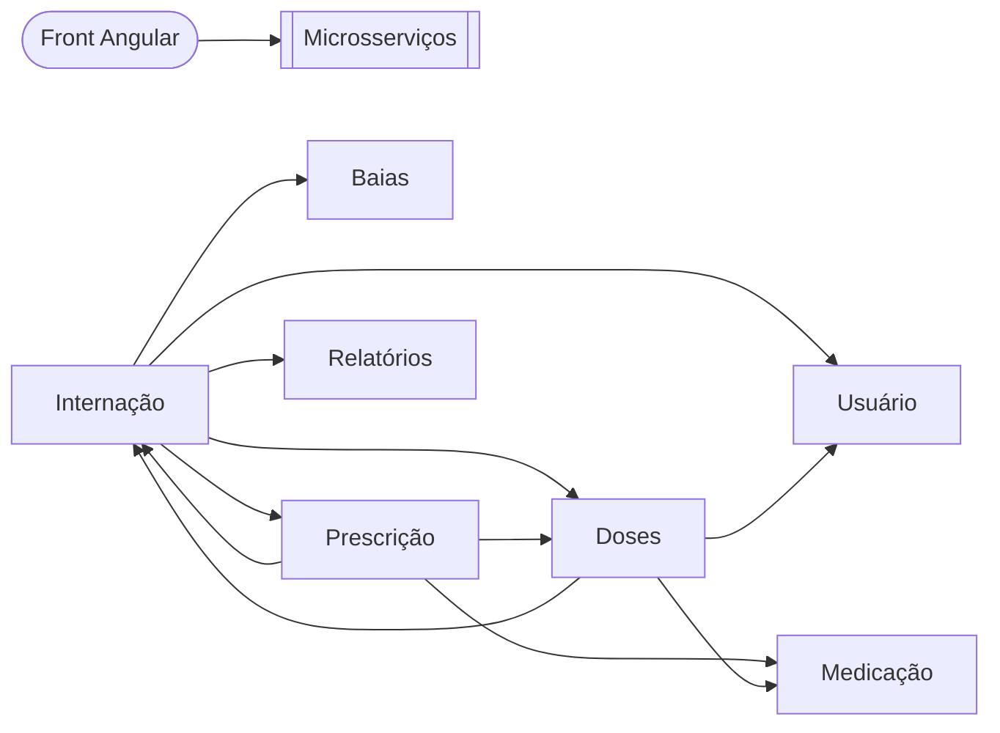

# Octopus · Sistema Plantão (VidaPet)


Sistema de internação e medicação da clínica veterinária **VidaPet**. Ele mostra, a qualquer hora do plantão,
quais doses estão atrasadas, quais vencem em breve e quais foram perdidas, e cuida do caminho do animal desde a
admissão até a saída da baia.

Projeto acadêmico da disciplina **Análise e Projeto de Sistemas II**, desenvolvido em 5 sprints pela squad Octopus.
**O projeto está concluído.**

| | |
| :--- | :--- |
| **Aplicação** | <https://clinicavidapet.vercel.app> (acesso com usuário cadastrado) |
| **Front-end** | [Bifaniii/Octopus-front](https://github.com/Bifaniii/Octopus-front) |
| **Back-end** | este repositório: 7 microsserviços, um por branch |

## Arquitetura

Cada seta sai do serviço que faz a chamada.



O **Relatórios** consulta os outros seis serviços para montar os documentos (essas setas ficaram fora do desenho
para manter a leitura).

### Microsserviços

| Serviço | Responsabilidade | Porta | Código |
| :--- | :--- | :--- | :--- |
| **Usuário** | Login e token JWT, recuperação de senha, perfis, tutores, animais e envio de e-mail ao tutor | 8080 | [`main`](https://github.com/Bifaniii/Octopus/tree/main/octopus-msusuario) |
| **Baias** | Cadastro de baias, tipo, capacidade e limite de 12 ativas | 8081 | [`feature/cadastro-baia`](https://github.com/Bifaniii/Octopus/tree/feature/cadastro-baia/ms-cadastro-baias) |
| **Medicação** | Medicamentos, esquema contínuo ou sintomático, interações proibidas e estoque em doses | 8082 | [`feature/register_medications`](https://github.com/Bifaniii/Octopus/tree/feature/register_medications/octopus-msmedications) |
| **Internação** | Admissão, ciclo de vida do animal internado, alta e liberação da baia | 8083 | [`feature/internacao`](https://github.com/Bifaniii/Octopus/tree/feature/internacao/ms-internacao) |
| **Prescrição** | Prescrições, geração dos horários, item "se necessário" e bloqueio de interações | 8084 | [`feature/prescricao`](https://github.com/Bifaniii/Octopus/tree/feature/prescricao/octopus-msprescricao) |
| **Doses** | Painel de doses, janela de aplicação, dose perdida e reaplicação | 8085 | [`feature/doses`](https://github.com/Bifaniii/Octopus/tree/feature/doses/octopus-msdoses) |
| **Relatórios** | Relatórios em PDF e XLSX, PDF da prescrição e resumo de alta; não tem banco de dados | 8086 | [`feature/relatorios`](https://github.com/Bifaniii/Octopus/tree/feature/relatorios/octopus-msrelatorios) |

### Como os serviços se comunicam

- **API REST** com JSON, em chamadas síncronas com tempo limite.
- **JWT:** só o serviço de Usuário emite o token. Os demais validam com a mesma chave (`JWT_SECRET`) e repassam o
  token quando chamam outro serviço, então as permissões do usuário continuam valendo.
- **Dados desacoplados:** um serviço guarda apenas o id do que pertence a outro, sem chave estrangeira entre eles.
  Cada serviço com banco tem as próprias migrations.

## Regras de negócio

| Regra | O que o sistema garante |
| :--- | :--- |
| RN-01 | Baia coletiva e de isolamento comportam 1 animal; ninhada, até 6 filhotes da mesma mãe |
| RN-02 | Animal com antirrábica vencida ou sem registro só pode ir para o isolamento |
| RN-03 | A dose só é registrada de 30 minutos antes até 30 minutos depois do horário previsto |
| RN-04 | Dose não aplicada dentro da janela é marcada como perdida automaticamente |
| RN-05 | Toda aplicação registra quem aplicou, data e hora, e não pode ser editada |
| RN-06 | Medicamentos com interação proibida não podem cair no mesmo horário |
| RN-07 | Dose contínua perdida é reaplicada e desloca as seguintes; a sintomática é pulada |
| RN-08 | A baia só é liberada com a saída física do animal, mesmo com a alta autorizada |

## Perfis de acesso

| Perfil | Principais ações |
| :--- | :--- |
| **Recepcionista** | Cadastra tutores e animais e registra a internação |
| **Veterinário** | Prescreve e dá alta |
| **Auxiliar** | Registra a aplicação das doses |
| **Administrador (TI)** | Gerencia os usuários e tem acesso às telas operacionais |

## Tecnologias

- Java 17, Spring Boot 4.1, Spring Data JPA, Spring Security com JWT, Bean Validation e Lombok
- MySQL com Flyway; H2 nos testes
- springdoc OpenAPI (Swagger)
- Docker, GitHub Actions e GitHub Container Registry
- Produção: microsserviços na AWS EC2, banco no Aiven e front-end na Vercel

## Como rodar

Pré-requisitos: Docker com Compose. Para rodar fora do Docker, Java 17 (o Maven Wrapper já vem no projeto).

### Serviço de Usuário (esta branch)

```bash
git clone https://github.com/Bifaniii/Octopus.git
cd Octopus
cp .env.example .env         # preencha as variáveis
openssl rand -base64 48      # sugestão para o JWT_SECRET
docker compose up --build
```

- Swagger: <http://localhost:8080/swagger-ui.html>
- No primeiro start é criado o administrador definido em `ADMIN_EMAIL` e `ADMIN_SENHA`.
- Faça login em `POST /api/auth/login` e use o token no botão **Authorize** do Swagger.

### Demais serviços

Cada um é autocontido na própria branch, com `Dockerfile`, `docker-compose.yml` e `.env.example` na pasta do módulo:

```bash
git checkout feature/doses   # exemplo
cd octopus-msdoses
cp .env.example .env
docker compose up --build
```

Para usar o sistema integrado, todos precisam do **mesmo `JWT_SECRET`**, e as variáveis `MS_*_URL` de cada `.env`
devem apontar para os serviços que ele chama.

## Testes e entrega

São mais de **350 testes automatizados** (JUnit 5, Mockito e MockMvc), distribuídos pelos sete serviços.

```bash
cd octopus-msusuario && ./mvnw test
```

Cada branch tem o seu pipeline no GitHub Actions: os testes rodam antes da entrega e, quando a versão do `pom.xml`
é nova, a imagem Docker é publicada e implantada na EC2.

## Organização do repositório

- Uma branch permanente por microsserviço; os módulos não são mesclados entre si.
- Pacote base `com.br.octopus_ms<area>` e schema versionado por migrations Flyway.
- Registros em uso não são apagados: são desativados, para preservar o histórico.

## Documentação

- [Termo de Abertura do Projeto](TAP.md)
- [Decisões de arquitetura (ADRs)](docs/adr)
- [Mapas de processo](docs/mapas-processo.html) (baixe e abra no navegador)
- [Arquitetura e convenções](CLAUDE.md)

## Squad Octopus

| Integrante | Papel |
| :--- | :--- |
| Douglas Rocha | Tech Lead |
| Guilherme Bifani | Dev Backend |
| Guilherme Soares | Dev Backend |
| Gustavo Amaral | Dev Frontend |
| Luigi Vasconcelos | Dev Fullstack |
| Marcos Vinicios | Product Owner |
| Miliani Alves | Scrum Master |
| Vitor Kimany | QA |
